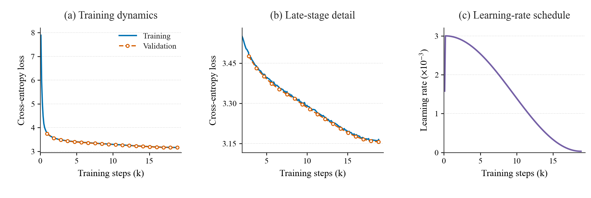

# LLMs from Scratch

My implementations of Assignments 1 and 3 from LLMs from Scratch, Fall 2025, taught by Kaifeng Lyu at IIIS, Tsinghua University.

Course assignment repository: [vfleaking/llms-from-scratch-fall-2025-assignment](https://github.com/vfleaking/llms-from-scratch-fall-2025-assignment).

The code covers BPE tokenization, Transformer, pretraining and evaluation. A **106M-parameter** model was trained on the **FineWeb-Edu 10BT subset using 8 × NVIDIA A100 80GB GPUs in 3 hours**.

## Implementation

- Byte-level BPE training, encoding and decoding, with a Qwen vocabulary adapter.
- Transformer with RMSNorm, SwiGLU, grouped-query attention and RoPE.
- AdamW, cosine learning-rate decay with warmup, gradient clipping and checkpointing.
- Memory-mapped token data, gradient accumulation, BF16 training and DDP.
- Hugging Face model export and zero-shot evaluation on HellaSwag, LAMBADA and ARC-Easy.

Pretraining uses the Qwen tokenizer and PyTorch SDPA. The Hugging Face adapter is based on the course scaffold.

## Training

| Setting | Value |
|---|---|
| Parameters | 106,117,120 |
| Layers / hidden size / MLP size | 12 / 512 / 1,024 |
| Attention heads / KV heads | 8 / 4 |
| Vocabulary size | 151,936 |
| Context length | 1,024 |
| Global batch size | 512 |
| Peak / minimum learning rate | 3e-3 / 3e-5 |
| Optimizer steps | 18,840 |
| Hardware | 8 × A100 80GB |
| Training time | ~3 hours |
| Final validation loss | 3.1560 |



## Evaluation

Results for `ckpt_18840`, evaluated in FP32 with a maximum sequence length of 1,024. `acc_norm` normalizes candidate log likelihood by character length.

| Task | Samples | acc | acc_norm |
|---|---:|---:|---:|
| HellaSwag | 10,042 | 28.61% | 30.82% |
| LAMBADA | 5,153 | 23.54% | N/A |
| ARC-Easy | 2,376 | 51.01% | 46.17% |

[Training log](results/ckpt_18840/training_log.json) · [Evaluation results](results/ckpt_18840/eval_results.json)

## Files

```text
foundations/              BPE tokenizer and reference Transformer
pretraining/
  src/                    Model, optimizer, data loading, training and evaluation
  src/settings/           Model configuration
  custom_model/           Hugging Face adapter
  convert_ckpt_to_hf.py    Checkpoint conversion
results/                  Training log and evaluation results
assets/                   Training curves
```

## Usage

Use Python 3.11 and a CUDA-compatible PyTorch installation.

```bash
pip install -r requirements.txt
```

Place the Qwen tokenizer in `pretraining/qwen3_tokenizer/`. Tokenize local FineWeb-Edu Parquet files:

```bash
python pretraining/src/tokenization.py \
  --input_dir /path/to/fineweb-edu/sample/10BT \
  --tokenizer_dir pretraining/qwen3_tokenizer \
  --output_dir pretraining/dataset
```

Training reads `train.bin` and `valid.bin` from that output directory. Hyperparameters are set in `pretraining/src/train.py`, and the model configuration is in `pretraining/src/settings/model_params.json`.

```bash
torchrun --standalone --nproc_per_node=8 pretraining/src/train.py

python pretraining/convert_ckpt_to_hf.py \
  --ckpt_path pretraining/checkpoint/ckpt_18840 \
  --out_dir pretraining/exports/ckpt_18840
```

Provide the three benchmark files to run evaluation:

```bash
python pretraining/src/eval.py \
  --model_dir pretraining/exports/ckpt_18840 \
  --tokenizer_dir pretraining/qwen3_tokenizer \
  --hellaswag /path/to/hellaswag.jsonl \
  --lambada /path/to/lambada/test.jsonl \
  --arc_easy /path/to/ARC-Easy-Test.jsonl \
  --output results/new_run/eval_results.json
```

Datasets, tokenizer files and model weights are stored separately.
